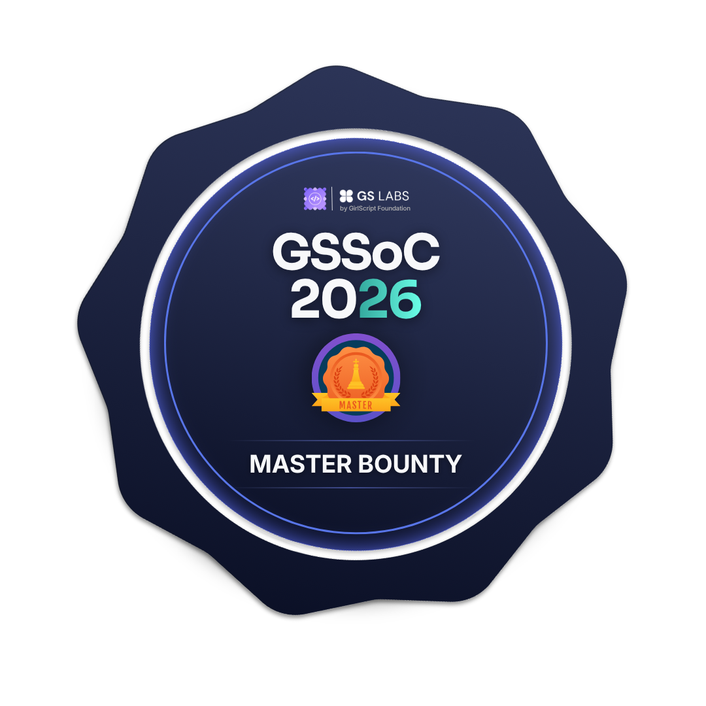
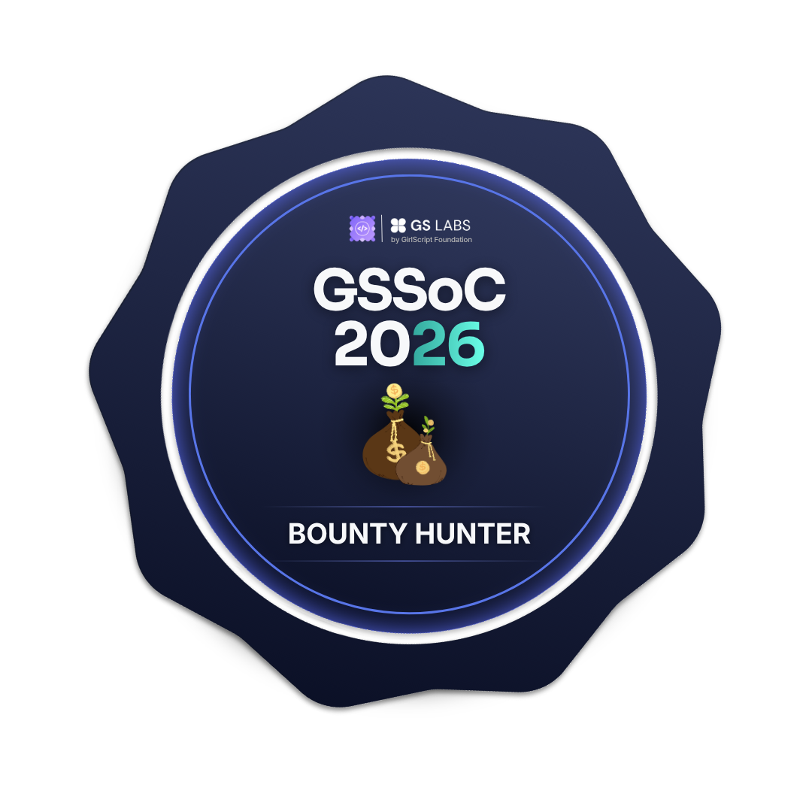
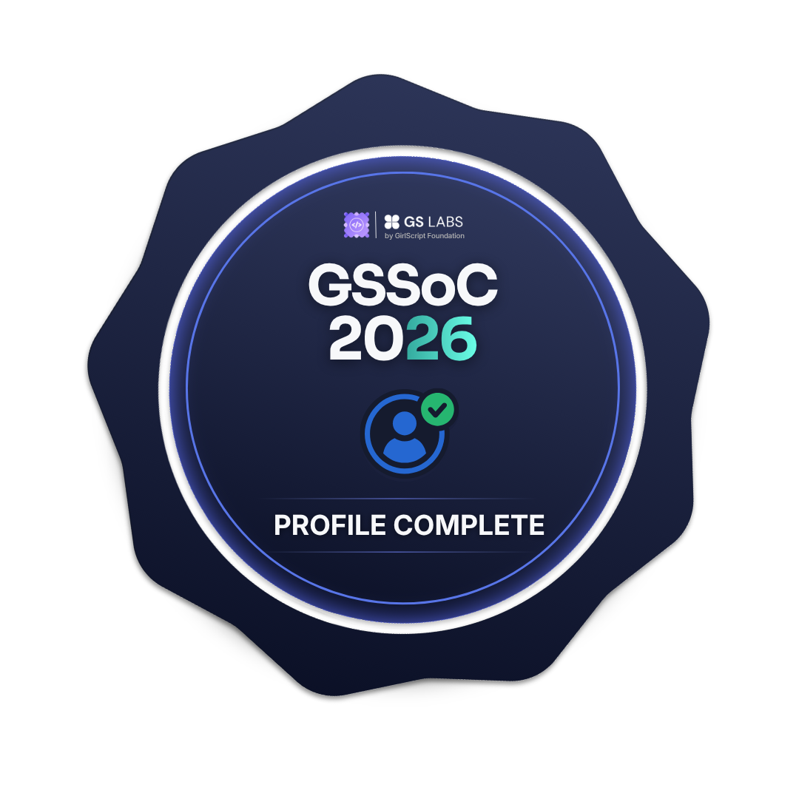
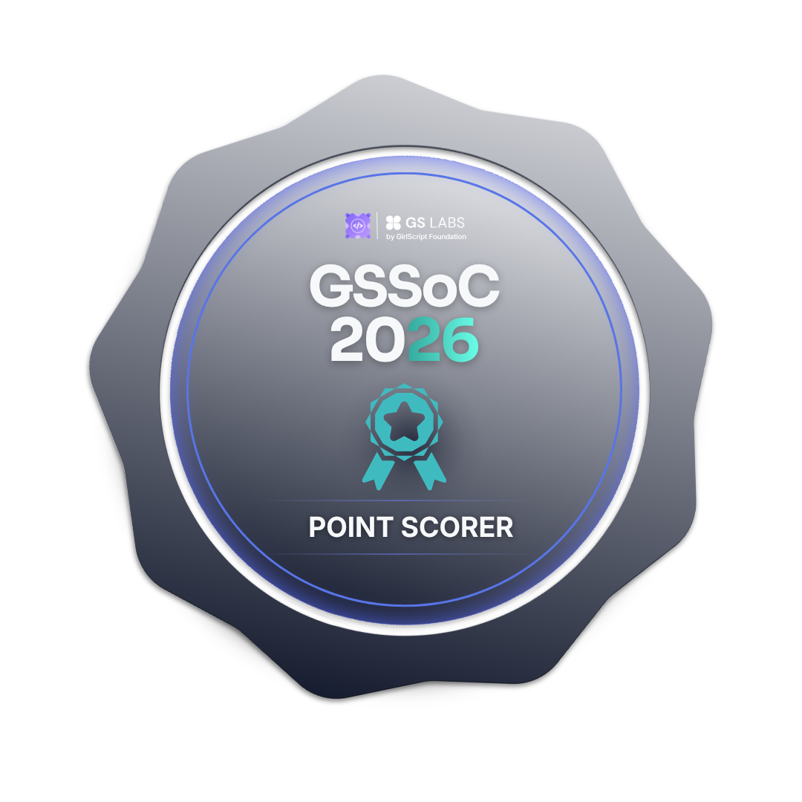

<!--
  GitHub Profile README — Mannat30
  Keep repository links and achievements accurate as your profile evolves.
-->

# Hi, I'm Mannat Sharma 👋

### Java Full Stack Developer | Backend Engineering

  

  
  &nbsp;
  
  &nbsp;
  

  📍 Jaipur, India &nbsp; • &nbsp; 🎓 B.Tech CSE, Poornima University

---

## 👩‍💻 About Me

I'm a B.Tech Computer Science student at **Poornima University, Jaipur**, interested in building useful, reliable software. I primarily work with **Java and Spring Boot** on the backend and **React** on the frontend, and I'm exploring how Generative AI can make applications more helpful.

 

| 🎓 Education | 🏅 Open Source | 🧩 Problem Solving |
|:---:|:---:|:---:|
| B.Tech CSE · CGPA **9.52** | **GSSoC 2026** Contributor · Top 12% | Practising DSA consistently |

 

- 🏗️ **Interests:** Backend engineering, system design, cloud computing and Generative AI.
- 🎯 **Goal:** Grow as a software engineer by building scalable, real-world applications.

---

## 🧰 Tech Stack

I focus on tools I have used while learning and building projects.

### Languages

  
  &nbsp;&nbsp;
  

### Backend & APIs

  
  &nbsp;
  
  &nbsp;
  
    
  
  &nbsp;
  
  &nbsp;
  

### Frontend

  

### Databases, Cloud & Developer Tools

  
  &nbsp;&nbsp;
  
  &nbsp;
  

### Generative AI

  
  &nbsp;
  

---

## 🚀 Featured Projects

<table>
  <tr>
    <td width="50%" valign="top">
      <h3>🛒 <a href="https://github.com/Mannat30/E-Commerce-Backend-MICROSERVICE">E-Commerce Backend Microservices</a></h3>
      
A Java and Spring Boot microservices project exploring service discovery, centralized configuration and distributed communication.

      
<strong>Tech:</strong> Java · Spring Boot · API Gateway · Eureka · Kafka · JWT · Resilience4j · Docker

    </td>
    <td width="50%" valign="top">
      <h3>📋 <a href="https://github.com/Mannat30/TASKFLOW">TaskFlow</a></h3>
      
A task management application with secure authentication and practical task workflows.

      
<strong>Tech:</strong> Spring Boot · React · JWT · MySQL · CRUD · Pagination

    </td>
  </tr>
  <tr>
    <td width="50%" valign="top">
      <h3>🩸 <a href="https://github.com/Mannat30/BLOOD-LINK">BloodLink</a></h3>
      
A blood donation platform concept focused on connecting people who need blood with potential donors.

      
<strong>Project:</strong> <a href="https://blood-link-ai.vercel.app/">View live project ↗</a>

    </td>
    <td width="50%" valign="top">
      <h3>🤖 <a href="https://github.com/Mannat30/CHATBOT-WITH-AI-INTEGRATION">AI Chatbot Integration</a></h3>
      
A Java-based chatbot application connecting a Spring Boot backend to an LLM API.

      
<strong>Tech:</strong> Java · Spring Boot · WebClient · Groq API · REST

    </td>
  </tr>
  <tr>
    <td width="50%" valign="top">
      <h3>💬 <a href="https://github.com/Mannat30/realtime-collaboration">Realtime Collaboration</a></h3>
      
A real-time collaboration and messaging application.

      
<strong>Tech:</strong> Java · Spring Boot · React · WebSockets

    </td>
    <td width="50%" valign="top">
      <h3>🔎 <a href="https://github.com/Mannat30?tab=repositories">More projects</a></h3>
      
Explore my repositories for more experiments, learning projects and ongoing development.

      
<a href="https://github.com/Mannat30?tab=repositories">Browse all repositories ↗</a>

    </td>
  </tr>
</table>

---

## 🏆 GSSoC 2026 — Open Source Badges

Proud to be a **GSSoC 2026 Contributor** and ranked in the **Top 12% of the leaderboard**.

  
  &nbsp;&nbsp;&nbsp;
  
  &nbsp;&nbsp;&nbsp;
  

  
  &nbsp;&nbsp;&nbsp;
  

  

---

## 🏅 GitHub Achievements

  

---

## 🌱 Currently Learning & Building

- Strengthening Java, Spring Boot and backend development fundamentals.
- Practising DSA and problem-solving patterns.
- Exploring system design and cloud computing.
- Building applications that integrate Generative AI and LLM APIs.
- Improving code quality through testing, documentation and open-source collaboration.

---

## 📊 GitHub Overview

  
  

  

  

Stats and trophy cards are generated by external services and may occasionally be delayed or unavailable.

---

## 🤝 Let's Connect

I'm happy to connect with fellow developers, learn from the community and collaborate on meaningful projects.

  
  &nbsp;
  

**Thanks for visiting my profile!**

*Learn consistently. Build thoughtfully. Contribute meaningfully.* ✨

